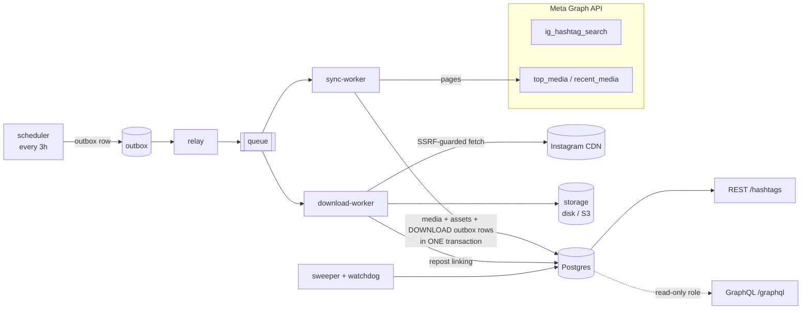

# Hashtag Tracker

A backend service that tracks the Instagram hashtag **`#matcha`**. It pulls top and recent posts from the Meta Graph API every 3 hours, stores their metadata in Postgres, downloads the media files, and removes duplicates, including reposts published under a new ID. It serves the data through a paginated REST API (`GET /hashtags`) and a GraphQL API for a dashboard.

Built with **TypeScript (strict) · Node.js 22 · Express 5 · Postgres 16 · Kysely**. It runs entirely locally by default. The queue, storage, secrets, scheduling and alerting each sit behind an interface with both a local and an AWS implementation (SQS, S3, Secrets Manager, EventBridge, SNS).

> The assignment asks for an `instructions.md` with specific section headers: [`instructions.md`](instructions.md) (setup, full variable table, tradeoffs, production notes, alert runbooks, AI usage). This README is the overview; the full design is in the [design spec](docs/superpowers/specs/2026-09-27-hashtag-tracker-design.md), and the build log is in the [implementation plan](docs/superpowers/plans/2026-09-27-hashtag-tracker.md).

---

## Contents

- [What it does](#what-it-does)
- [The four hard problems](#the-four-hard-problems)
- [Architecture](#architecture)
- [Quick start](#quick-start)
- [API reference](#api-reference)
- [Configuration](#configuration)
- [Operations](#operations)
- [Testing](#testing)
- [Project layout](#project-layout)
- [Production (AWS)](#production-aws)
- [Known limitations](#known-limitations)

---

## What it does

| Area | Behaviour |
|---|---|
| **Ingestion** | Looks up the hashtag ID once and stores it, so `ig_hashtag_search` is never called again. Every 3 hours, syncs both the `top` and `recent` edges page by page, stopping early once it reaches posts it has already seen. |
| **Storage** | All tables are created by migrations. Media files are stored locally or in S3, named by their SHA-256 hash. The raw Meta payload is kept for 30 days, and posts are deleted after 180 days. |
| **Deduplication** | A post seen twice (same `ig_media_id`) is stored once. Reposts under a new ID are detected by identical file bytes, then by normalized caption, linked into a repost group, and hidden from the feed. |
| **Engagement history** | A snapshot of like and comment counts is saved whenever they change, and the dashboard can chart it by hour or day. |
| **APIs** | `GET /hashtags`: cursor-paginated, newest first by Instagram post time, with tamper-proof signed cursors. `POST /graphql`: dashboard queries on a separate read-only database role, so dashboard load can't slow ingestion. |
| **Reliability** | A transactional outbox, a relay, and a sweeper that repairs stuck work. Downloads hold time-limited leases, and failed jobs retry with exponential backoff. Shutdown on `SIGTERM` is graceful. |
| **Protection** | Downloads are guarded against SSRF. REST is rate-limited per IP and GraphQL per API key, by query cost. API keys are stored hashed. Logs redact secrets. |
| **Observability** | Structured logs, Prometheus metrics, and a watchdog that raises alerts backed by Postgres. An operator status endpoint shows sync, queue and alert state. |

## The four hard problems

The assignment called out four failure modes explicitly. Here is how each one is handled.

| # | Failure mode | How it's handled |
|---|---|---|
| **A** | **More than 500 posts in 3 hours: posts silently missed** | Each sync stops at a *watermark*, the newest post time from the last complete sync minus a small margin for clock skew. If it reaches the 500-item cap first, the run is marked `TRUNCATED` with an open *gap*, and a follow-up job continues from the saved cursor. The gap is closed when a follow-up catches up. If it can't be closed within 24 hours, it's marked unrecoverable and raises a critical alert. It is never dropped silently. Repeated truncation also shortens the delay before follow-ups. |
| **B** | **Media URLs expire before download** | The download job is queued *in the same transaction* that saves the post, so it starts within seconds. The URL's expiry time (Instagram's `oe` parameter) is stored. A 403 or 410 marks the file `url_expired`, and the next sync that sees a fresh URL for that post queues it again. |
| **C** | **Reposts under a new ID** | After download, a file whose SHA-256 matches an existing post's file is linked as a repost. If the bytes differ, a normalized-caption hash (captions of 40+ characters only) is the fallback. Reposts are stored and linked into a `repost_group` with combined engagement totals, but hidden from `GET /hashtags` by default. |
| **D** | **Worker crashes between saving and queueing: job lost** | Transactional outbox: the post, its files and the outbox row are written in one transaction. A relay publishes outbox rows to the queue, and a sweeper repairs anything stuck: expired download leases, and pending files with no outbox row. Delivery is at-least-once, and every job handler is safe to run twice. |

Each failure mode has a scenario test that reproduces it against real Postgres (`test/scenario/`).

## Architecture



**Processes.** One codebase has five *roles*, chosen with `APP_ROLES`: `api`, `sync-worker`, `download-worker`, `relay` and `scheduler`. Locally they all run in one process. In production each is its own ECS service.

**Ports and adapters.** Business logic in `src/services` depends only on the interfaces in `src/ports`. Each interface has a local and an AWS implementation, and both pass the same shared contract test suite (`test/contract/`):

| Port | Local | AWS |
|---|---|---|
| `Queue` | in-memory | SQS |
| `BlobStorage` | local disk | S3 (pre-signed read URLs) |
| `SecretProvider` | environment variables | Secrets Manager (5-minute cache) |
| `Scheduler` | node-cron | EventBridge Scheduler (created by Pulumi) |
| `AlertSink` | log, plus Slack webhook if `SLACK_WEBHOOK_URL` is set | SNS |
| `Metrics` | Prometheus | CloudWatch Embedded Metric Format (EMF) |

The backend switches with `SECRETS_SOURCE=env|aws`.

**Database roles.** Three Postgres roles with least privilege: `tracker_migrator` owns the schema and is used only by `npm run migrate`, `tracker_app` has read/write access to rows but can't change the schema, and `tracker_graphql` is read-only with a 2-second statement timeout.

## Quick start

**Requirements:** Node.js 22+, Docker, and a Meta access token plus an Instagram Business account ID.

```bash
npm install
docker compose up -d        # Postgres 16 on localhost:5432
cp .env.example .env        # then fill in the values below
```

In `.env`, set:
- `META_ACCESS_TOKEN` and `META_IG_USER_ID` (the Instagram Business account ID).
- `CURSOR_SIGNING_KEYS`, generated with `echo "k1:$(openssl rand -base64 32)"`.

```bash
npm run db:setup            # once: lets the database roles log in (runs as the superuser)
npm run migrate             # creates all tables, as tracker_migrator
npm run apikey:create -- --name dashboard --scopes dashboard:read
npm run dev                 # starts every role; the first sync starts immediately
```

Every command loads `.env` on its own, and variables already set in your shell take precedence. The app never runs migrations on startup, so run `npm run migrate` after pulling a change that adds one.

On first start the app looks up the hashtag, queues a sync for both edges, then keeps syncing every 3 hours. Check that it worked:

```bash
curl -s "localhost:3000/hashtags?limit=5"
curl -s localhost:3000/readyz
```

> **Port 5432 already in use?** A Postgres installed directly on your machine (Homebrew or Postgres.app) takes `localhost:5432` ahead of Docker. Map the container to another port and update the four `DATABASE_URL*` values to match.

Run one role only, for example just the API:

```bash
APP_ROLES=api npm run dev
```

## API reference

### `GET /hashtags`

Stored posts for a hashtag, newest first by Instagram post time (`postedAt`, not insert time). Reposts are left out.

| Query param | Default | Notes |
|---|---|---|
| `tag` | `HASHTAG` (`matcha`) | Unknown tag → `404 hashtag_not_found` |
| `limit` | `20` | Capped at `100`; invalid values fall back to 20 |
| `cursor` | — | `pageInfo.nextCursor` from the previous page. Signed with HMAC, so a tampered cursor gets `400 invalid_cursor` |

```json
{
  "data": [
    {
      "id": "137",
      "igMediaId": "18090381617440645",
      "mediaType": "VIDEO",
      "caption": "matcha morning ...",
      "permalink": "https://www.instagram.com/p/...",
      "postedAt": "2026-09-28T17:54:12.000Z",
      "likeCount": 12,
      "commentsCount": 1,
      "assets": [
        { "position": 0, "kind": "video", "status": "stored", "contentType": "video/mp4", "url": "/files/sha256/ab/ab12....mp4" }
      ]
    }
  ],
  "pageInfo": { "nextCursor": "eyJ...", "hasMore": true }
}
```

`likeCount` is `null` when Meta hides a post's like count. `assets[].url` is set only once the file is stored: a local `/files/...` path, or a 15-minute pre-signed S3 URL. File `status` is one of `pending`, `downloading`, `stored`, `url_expired`, `failed` or `no_url`. `no_url` means Meta returned no media URL, which happens for some videos. A carousel is stored with its cover image only (see [limitations](#known-limitations)).

### `POST /graphql` (dashboard)

Requires `Authorization: Bearer <key>` with the `dashboard:read` scope.

```graphql
type Query {
  post(id: ID!): Post
  posts(first: Int!, after: String): PostConnection!
  repostGroup(id: ID!): RepostGroup
}

type Post {
  id: ID!  igMediaId: String!  caption: String  mediaType: MediaType!
  permalink: String!  postedAt: DateTime!  likeCount: Int  commentsCount: Int
  assets: [Asset!]!
  engagementHistory(from: DateTime!, to: DateTime!, bucket: Bucket!, first: Int!): [EngagementPoint!]!
  repostGroup: RepostGroup
}

type RepostGroup {
  id: ID!  canonical: Post!  size: Int!  totalLikes: Int!  totalComments: Int!
  members(first: Int!, after: String): PostConnection!
}
```

```bash
curl -s -X POST localhost:3000/graphql \
  -H "Authorization: Bearer dash_<keyId>_<secret>" -H 'content-type: application/json' \
  -d '{"query":"{ posts(first:5){ edges{ node{ igMediaId likeCount assets{ kind status } } } } }"}'
```

**Limits:**
- **Query shape:** depth 5, 10 aliases, cost 1000, and `first` at most 50.
- **Per-key budget:** each API key gets `GRAPHQL_COST_PER_MIN` cost units per minute (default 10,000).
- **Caching:** responses are cached for 30 seconds, and the cache is cleared whenever a sync finishes.
- **With `NODE_ENV=production`:** only allowlisted (persisted) queries are accepted, introspection is off, and unexpected errors are masked.

**Speed:** resolvers batch their database lookups with DataLoader, and a test confirms a nested page query makes exactly 3 SQL queries.

### Operator and health endpoints

| Endpoint | Auth | Purpose |
|---|---|---|
| `GET /healthz` | none | Liveness: always 200 while the process runs |
| `GET /readyz` | none | Readiness: Postgres reachable, relay and sweeper checked in recently; 503 otherwise |
| `GET /internal/status` | `admin` key | Last 10 sync runs, outbox backlog, file counts by status, firing alerts |
| `DELETE /internal/media/:igMediaId` | `admin` key | Deletes one post and its files (erasure or takedown requests) |
| `GET /files/*` | none | Serves locally stored media (local storage only) |
| `GET :9100/metrics` | none | Prometheus metrics on a separate port; don't expose it publicly |

**API keys** have the format `dash_<keyId>_<secret>`. Only a SHA-256 hash of the secret is stored, and keys are compared in constant time.

```bash
npm run apikey:create -- --name ops --scopes admin [--expires-days 90]
npm run apikey:revoke -- --key-id <keyId>
```

## Configuration

Everything is set through environment variables, validated at startup with zod. The full table with defaults is in [`instructions.md` → vars](instructions.md#vars), and [`.env.example`](.env.example) is a filled-in template. The most important ones:

| Variable | Default | Purpose |
|---|---|---|
| `META_ACCESS_TOKEN` / `META_IG_USER_ID` | — | Meta credentials (**required**; token stays in `.env` only) |
| `META_APP_SECRET` | — | Enables `appsecret_proof` on every Meta call |
| `HASHTAG` | `matcha` | Hashtag to track |
| `SYNC_INTERVAL_CRON` / `SYNC_MAX_ITEMS` | `0 */3 * * *` / `500` | Sync schedule and per-run item cap |
| `DATABASE_URL` / `_READONLY` / `_MIGRATOR` / `_ADMIN` | — | App, dashboard, migration, and one-time setup connections |
| `CURSOR_SIGNING_KEYS` | — | `kid:base64key[,kid:key]` for signing pagination cursors (supports rotation) |
| `APP_ROLES` | all five | Which roles this process runs |
| `SECRETS_SOURCE` | `env` | `aws` switches every adapter to AWS |
| `STORAGE_DIR` | `./storage` | Local media directory |
| `REST_RATE_PER_MIN` / `REST_BURST` | `60` / `20` | Per-IP REST rate limit |

## Operations

- **Logs:** structured JSON (pino) with secrets redacted. Each sync has a `sync_run_id` that appears in every log line and job for that sync, from fetch to stored file.
- **Metrics:** `meta_calls_total{endpoint,code}`, sync and page counters, download outcomes, outbox publishes, and request duration.
- **Alerts:** a watchdog backed by Postgres fires and resolves each alert exactly once:

  | Alert | Severity |
  |---|---|
  | `sync_overdue:{edge}` | critical |
  | `outbox_stalled` | critical |
  | `freshness_burn_rate_fast` | critical |
  | `freshness_burn_rate_slow` | warning |
  | `sync_gap_unrecoverable:{runId}` | critical |

  Each has a runbook in [`instructions.md` → runbooks](instructions.md#runbooks).
- **Meta rate limits:** the client reads Meta's usage headers and slows down above 80% usage. At 100% it pauses until Meta's reset time. Errors are sorted into three kinds: *fatal* (for example an invalid token; fails immediately), *rate limit* (resumes from the saved cursor later) and *temporary* (exponential backoff, limited retries). A retry continues the same sync run. If Meta says a page is too big, the client retries that page at page sizes 25, then 10, then 5.
- **Useful SQL:**
  ```sql
  SELECT edge, status, pages, items_fetched, items_new, gap_status, error_code
    FROM sync_runs ORDER BY started_at DESC LIMIT 10;
  SELECT status, count(*) FROM media_assets GROUP BY 1;
  SELECT dup_reason, count(*) FROM media WHERE duplicate_of_id IS NOT NULL GROUP BY 1;
  ```

## Testing

```bash
npm test                 # all tests; Docker must be running
npm run typecheck        # src/
npm run typecheck:all    # src/ + test/
```

About 380 tests in five layers. **Postgres and AWS are never faked:** integration tests run against real Postgres 16 and LocalStack through Testcontainers.

| Layer | Directory | Covers |
|---|---|---|
| Unit | `test/unit` | Mapper, watermark and stop logic, cursors, SSRF rules, backoff, Meta throttle, SLO maths, workers |
| Contract | `test/contract` | One shared suite each for the queue, storage, secrets, alert and Meta implementations (local and AWS) |
| Integration | `test/integration` | Repositories, migrations, database role privileges (run as the real roles), fresh-install setup, AWS adapters |
| Scenario | `test/scenario` | Failure modes A–D end to end, retries and resume, retention, repost linking, crash recovery |
| HTTP | `test/http` | REST and GraphQL behaviour, auth, rate limits, query limits, route isolation, the N+1 query check |

A migration-compatibility test compares the live schema with a saved baseline, so a new migration can't remove or retype a column that older code still uses during a rolling deploy.

## Project layout

```
src/
  adapters/      local + AWS implementations of every port (meta, queue, storage, secrets, metrics, alerts, …)
  cli/           API-key create/revoke
  config/        env schema (zod) and .env loading
  db/            Kysely pool, migrations/ (static registry), repositories/, grants, role setup
  domain/        pure logic: mapper, watermark, cursor signing, SSRF rules, URL expiry, captions, API keys
  graphql/       schema, resolvers, DataLoaders, plugins (limits, allowlist, cost budget)
  http/          Express app, routes/, auth, rate limiting, logging
  ports/         interfaces the services depend on
  services/      sync, download, repost linking, relay, sweeper, watchdog, retention, bootstrap
  workers/       queue consumers for sync and download jobs
  index.ts       wiring: picks adapters, starts the configured roles
test/            unit · contract · integration · scenario · http (+ helpers, fixtures)
infra/           Pulumi (TypeScript) stack + CrossGuard policy pack
docs/            design spec and implementation plan
```

## Production (AWS)

`infra/` is a standalone Pulumi TypeScript project for the production stack:
- A VPC, with **ECS Fargate** services, one per role, plus a one-off migration task that runs before each deploy.
- RDS Postgres, S3, SQS, and an EventBridge Scheduler rule.
- Secrets Manager secrets, created empty.
- An ALB with WAF in front, and a Network Firewall egress allowlist.
- A CrossGuard policy pack that enforces least-privilege IAM, with unit tests that use Pulumi's mocks.

`pulumi up` has never been run against a real AWS account. Production credentials, the rules for backward-compatible migrations, and what fails first at scale are covered in [`instructions.md` → production](instructions.md#production).

## Known limitations

- **Carousels keep only their cover image.** Asking Meta for carousel `children` on hashtag results makes the live API reject the request ("reduce the amount of data"). Posts on a hashtag belong to other accounts, so the rest of a carousel can't be fetched post by post either.
- **Repost detection** catches identical files and matching captions only. Re-encoded or cropped reposts aren't detected.
- **Meta's limits** of about 30 unique hashtags per account per 7 days, and about 200 calls per hour, cap how many hashtags one account can track.
- **Only SLO 1 (freshness) is measured automatically.** The other SLOs are defined in the spec but have no automated measurement yet.
- **Distributed tracing** isn't implemented; `sync_run_id` connects the logs instead.

The full list, with reasoning for each, is in [`instructions.md` → tradeoffs](instructions.md#tradeoffs).
